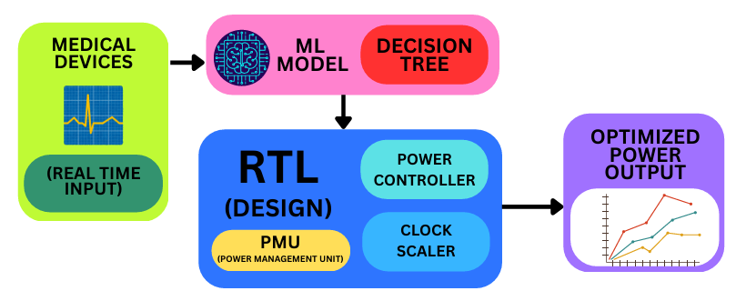
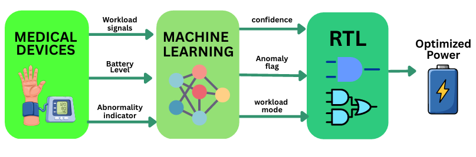
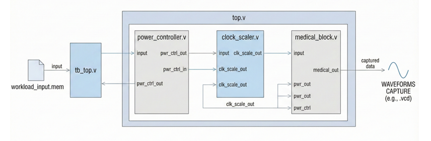
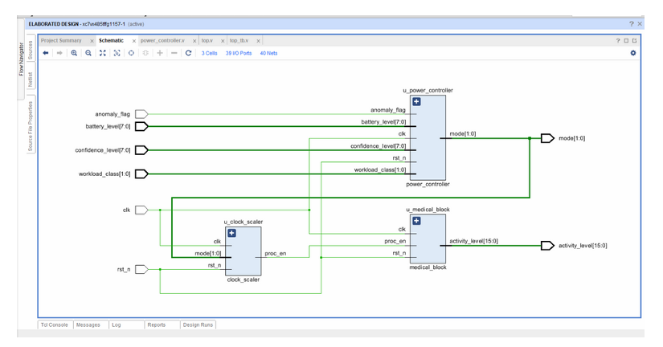
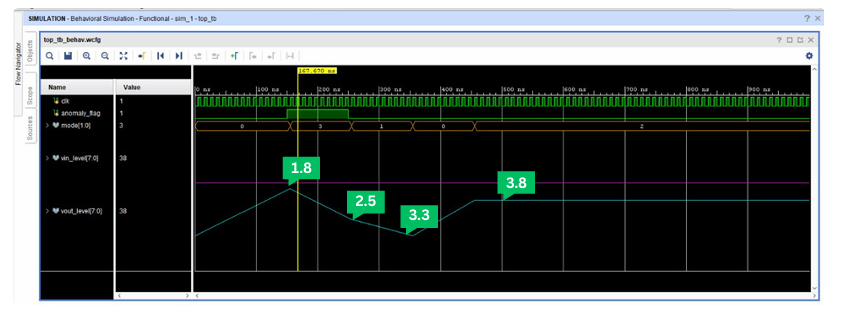

# ML-Integrated RTL Power Manager for Smart Health Monitoring

An intelligent power management system that combines a **Decision Tree Machine Learning model** with an **RTL-based Power Manager** to perform real-time Dynamic Voltage and Frequency Scaling (DVFS) for FPGA-enabled medical devices.

Fully designed, simulated, and validated on **Xilinx Kria KV260** AI Vision FPGA board.

---

## Project Highlights

- Decision Tree based real-time workload prediction
- Adaptive Voltage & Frequency Scaling (DVFS)
- Four intelligent power modes (Low / Medium / High / Emergency)
- Battery-aware and confidence-aware control logic
- Instant emergency response on anomaly detection
- Complete RTL design + Hardware implementation on Kria KV260

---

## System Overview

Medical device parameters (sensor activity, battery level, signal quality) are processed by a Decision Tree ML model. The model generates:

- Workload Class
- Confidence Level
- Battery Status
- Anomaly Flag

These signals drive the RTL Power Controller, which dynamically selects the appropriate voltage island and clock frequency.

### Power Modes

| Mode   | Description              | Voltage |
|--------|--------------------------|---------|
| Mode 0 | Low Power                | 1.8 V   |
| Mode 1 | Medium Performance       | 2.5 V   |
| Mode 2 | High Performance         | 3.3 V   |
| Mode 3 | Emergency / Critical     | 3.8 V   |

---

## Architecture

---

## Working Flow

---

## RTL Design

Key modules implemented in Verilog:

- `power_controller.v` – Mode decision based on ML outputs
- `clock_scaler.v` – Frequency scaling using clock enables
- `medical_block.v` – Simulates medical processing activity
- `top.v` – Top-level integration
- `tb_top.v` – Testbench

---

## Simulation Results

- Clean and stable voltage transitions across modes
- Instant switch to maximum voltage (3.8 V) during anomaly
- Proper tracking of voltage islands

---

## Hardware Implementation

Successfully deployed and tested on **Xilinx Kria KV260** AI
